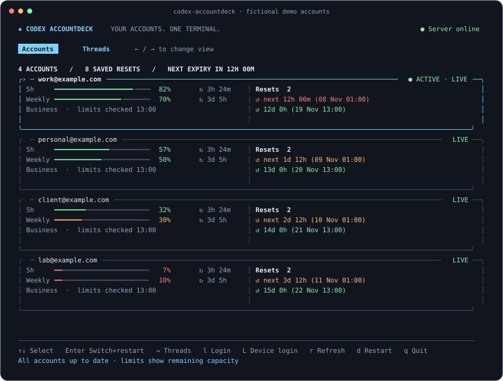

<div align="center">

# 🃏 Codex AccountDeck

**All your Codex accounts. One terminal.**

Switch accounts, watch your quotas, catch expiring resets, and rename threads.


[](LICENSE)

</div>



## ✨ Your accounts at a glance

- **📊 Quotas:** stacked 5h and weekly bars with remaining capacity and renewal times.
- **⏳ Resets:** saved reset credits, countdowns, and colored expiry warnings.
- **🔀 Switching:** select an account with the arrow keys; Enter switches and restarts the Codex daemon.
- **✏️ Threads:** press → to search and rename threads, with their familiar CLI colors.

Saved limits appear immediately; live data loads in the background. Four accounts fit in **80 × 24**. Larger lists scroll, and larger terminals show more detail.

## 🚀 Quick start

You need **Python 3.10+ with `curses`**, the [Codex CLI](https://github.com/openai/codex), and [Codex-Auth](https://github.com/Loongphy/codex-auth) on your `PATH`. Linux and WSL are the tested platforms. The thread renamer is bundled.

### Homebrew

```bash
brew install nerdworldDE/tap/codex-accountdeck
codex-accountdeck
```

Homebrew installs a compatible Python automatically. You still need Codex CLI and Codex-Auth.

### npm · directly from GitHub

```bash
npm install -g git+https://github.com/nerdworldDE/codex-accountdeck.git
codex-accountdeck
```

This installs the bundled Python application, with no Node runtime dependencies or install scripts. Python 3.10+ with `curses` must already be available as `python3`. The package has not been published to the npm registry; use the GitHub URL above.

### Python · pipx / uv

```bash
pipx install git+https://github.com/nerdworldDE/codex-accountdeck.git
# Or: uv tool install git+https://github.com/nerdworldDE/codex-accountdeck.git
codex-accountdeck
```

<details>
<summary>Run directly from source, without installing a Python package</summary>

```bash
git clone https://github.com/nerdworldDE/codex-accountdeck.git
cd codex-accountdeck
./codex-accountdeck
```

No sibling projects are needed. From this checkout, `pipx install .` / `uv tool install .` also works. `python3 install_hub.py` installs a launcher in `~/.local/bin`; keep the checkout in place and ensure that directory is on your `PATH`.

</details>

If the Codex command-line tools are not installed yet:

```bash
npm install -g @openai/codex @loongphy/codex-auth
```

No accounts yet? Press **`l`** to sign in through your browser, or **`L`** for a device code. AccountDeck returns to the overview after login and restarts the background service.

## ⌨️ Make yourself at home

| Key | Accounts | Threads |
| :--- | :--- | :--- |
| **↑ / ↓** | Select account | Select thread |
| **Enter** | Switch account + restart daemon | Rename selected thread |
| **→ / ←** | Open Threads | Back to Accounts |
| **`l` / `L`** | Browser / device-code login | — |
| **`r`** | Refresh limits and resets | Reload threads |
| **`d`** | Start / restart daemon | — |
| **`/`** | — | Search loaded threads |
| **`q` / Esc** | Quit | Quit / cancel editing |

In a text field, arrow keys move the cursor. Empty rename submissions cancel. **Ctrl+C during login** returns to the TUI.

🟢 More than 7 days left · 🟠 Within 7 days · 🔴 Within 1 day

## ⚙️ A few useful options

```bash
codex-accountdeck --renamer          # Start in Threads
codex-accountdeck --offline          # Saved quotas; no account/daemon actions
codex-accountdeck --warning-days 10  # Warn earlier about expiring resets
codex-accountdeck --interval 60      # Refresh every minute
codex-accountdeck --help             # All options
```

`CODEX_HOME` and `--codex-home` select the Codex data directory. Refresh defaults to **3 minutes**. Offline mode still allows local thread renaming.

Optional source-checkout shortcuts: `python3 install_hub.py --shortcuts` adds `sw`/`ws`/`sww` for Accounts and `cr`/`cn` for Threads. It backs up `~/.profile` first. Reload with `. ~/.profile`. Normal installation leaves your shell configuration alone.

## 🔐 Local by design

AccountDeck reads your local Codex-Auth account registry. Usage requests send each account's access token directly to ChatGPT; redirects are blocked. Account switching and login are delegated to Codex-Auth. Thread renaming uses local metadata, with a local app-server fallback.

**No model calls, telemetry, automatic reset redemption, or token logging.** `CACHED` and `NEEDS ATTENTION` distinguish saved values and failed refreshes from live data. ChatGPT's usage/reset endpoints are internal and can change.

## 🛠️ Development

```bash
python3 -m unittest discover -v
```

Tests use fictional accounts and temporary thread databases, including complete keyboard and login journeys in a pseudoterminal. See [development notes](docs/development.md) for builds and [legacy reset tools](docs/legacy-resets.md) for the original desktop/one-shot utilities.

---

Made for people who have more Codex accounts than spare attention. 💛

[MIT](LICENSE) · Independent community project, not affiliated with OpenAI. Thanks to [Codex-Auth](https://github.com/Loongphy/codex-auth) for account management.
