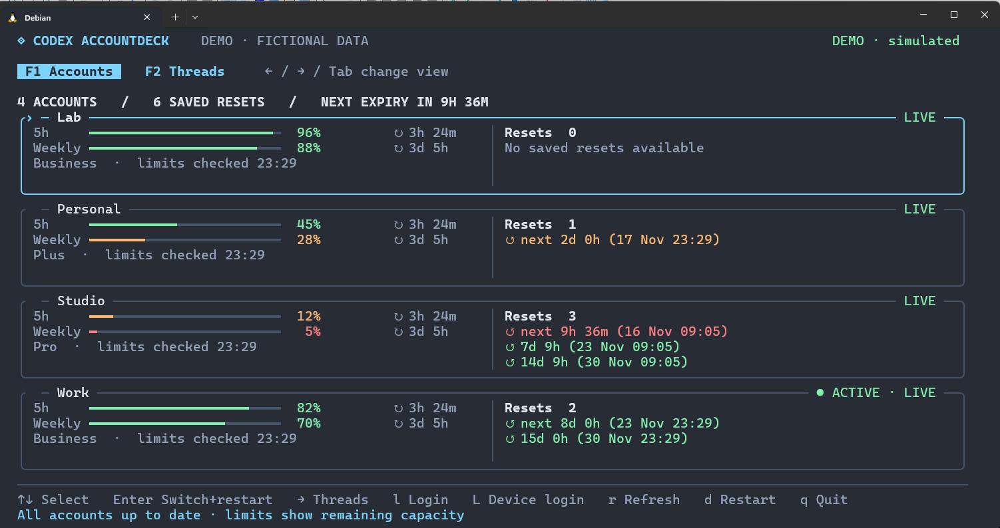
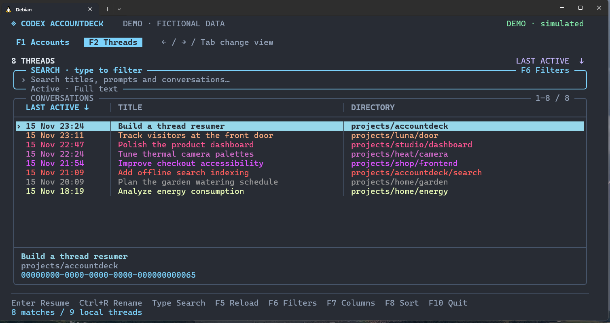

<div align="center">

# 🃏 Codex AccountDeck

**All your Codex accounts. One terminal.**

Switch accounts, watch your quotas, catch expiring resets, and find, rename or resume local threads hidden after an account switch.


[](LICENSE)

</div>

**Accounts — quotas, reset expiry and switching**



**Threads — search, rename and resume across local projects**



Both screenshots show the running TUI in demo mode with fictional data.

## ✨ Your accounts at a glance

- **📊 Quotas:** stacked 5h and weekly bars with remaining capacity and renewal times.
- **⏳ Resets:** saved reset credits, colored expiry warnings, and redemption from the selected account.
- **🔀 Switching:** select an account with the arrow keys; Enter switches and restarts the Codex daemon.
- **🧵 Threads:** press **F2** to browse all local threads with their familiar CLI colors. Type to search, **Enter** to resume, or **Ctrl+R** to rename.
- **🔎 Find conversations:** title matches appear first, followed by user prompts and other conversation text. Filter projects including subfolders, status, source and more.

Saved limits appear immediately; live data loads in the background. Four accounts fit in **80 × 24**. Larger lists scroll, and larger terminals show more detail.

## 🧭 Missing threads after switching accounts?

**Since Codex CLI 0.168.0, new local threads are filtered by the signed-in ChatGPT account in the native history and resume pickers.** If you use multiple accounts on the same computer, switching accounts can make threads disappear from the overview, so you can no longer select them there to resume. This account-scoped discovery was introduced in [OpenAI's 0.168.0 release notes](https://github.com/openai/codex/releases/tag/rust-v0.168.0).

The conversations can still exist locally: the [official app-server documentation](https://github.com/openai/codex/blob/rust-v0.169.0/codex-rs/app-server/README.md#local-history-by-account) says direct access by thread ID remains available. AccountDeck reads your local thread metadata across accounts, lets you search by title, prompts and conversation text, and resumes the selected thread in its original directory using your current login.

Other users report the same CLI symptom and related Desktop problems after account switching. See [verified sources and community reports](docs/thread-visibility.md) for the distinction between account-filtered CLI history and missing Desktop project organization.

## 🚀 Quick start

You need **Python 3.10+ with `curses`**, the [Codex CLI](https://github.com/openai/codex), and [Codex-Auth](https://github.com/Loongphy/codex-auth) on your `PATH`. Tested on Linux/WSL and macOS, including automated terminal tests. The thread renamer is bundled.

**1.4.0** adds saved reset redemption and a persistent thread index for faster search as you type. Existing Homebrew users can update with `brew update` followed by `brew upgrade nerdworldDE/tap/codex-accountdeck`.

### Homebrew

```bash
brew install nerdworldDE/tap/codex-accountdeck
codex-accountdeck
```

Homebrew installs a compatible Python automatically. You still need Codex CLI and Codex-Auth.

### npm · directly from GitHub

```bash
npm install -g git+https://github.com/nerdworldDE/codex-accountdeck.git
codex-accountdeck
```

This installs the bundled Python application, with no Node runtime dependencies or install scripts. Python 3.10+ with `curses` must already be available as `python3`. The package has not been published to the npm registry; use the GitHub URL above.

### Python · pipx / uv

```bash
pipx install git+https://github.com/nerdworldDE/codex-accountdeck.git
# Or: uv tool install git+https://github.com/nerdworldDE/codex-accountdeck.git
codex-accountdeck
```

<details>
<summary>Run directly from source, without installing a Python package</summary>

```bash
git clone https://github.com/nerdworldDE/codex-accountdeck.git
cd codex-accountdeck
./codex-accountdeck
```

No sibling projects are needed. From this checkout, `pipx install .` / `uv tool install .` also works. `python3 install_hub.py` installs a launcher in `~/.local/bin`; keep the checkout in place and ensure that directory is on your `PATH`.

</details>

If the Codex command-line tools are not installed yet:

```bash
npm install -g @openai/codex @loongphy/codex-auth
```

No accounts yet? Press **`l`** to sign in through your browser, or **`L`** for a device code. AccountDeck returns to the overview after login and restarts the background service.

## 🎭 Screenshot demo

```bash
codex-accountdeck --demo             # Four fictional accounts and simulated quotas
codex-accountdeck --demo --threads   # Search, resume and rename nine example conversations
```

The **DEMO · FICTIONAL DATA** badge stays visible. Work, Personal, Studio and Lab have different quotas, reset counts and expiry colors. The example conversations cover multiple projects and subfolders, with one archived conversation for the status filter.

Both tabs are interactive. Account switching, reset redemption, and daemon actions are simulated. `l` / `L` adds another fictional account. Enter in Threads opens the example conversation and Enter again returns to AccountDeck. Press **Ctrl+R** to rename the selected thread. Type **`shutter`** to find a match inside the thermal camera conversation.

Demo mode always uses a fresh temporary data directory, even when `CODEX_HOME` or `--codex-home` points at your real installation. It reads no real accounts or conversations, sends no usage requests, and starts no Codex/Auth subprocesses. Data and view changes disappear when the demo exits. No installed Codex CLI or Codex-Auth is needed for the demo.

## ⌨️ Make yourself at home

| Key | Accounts · F1 | Threads · F2 |
| :--- | :--- | :--- |
| **F1 / F2** | Open Accounts | Open Threads |
| **← / → / Tab** | Switch tabs | Switch tabs |
| **↑ / ↓, PgUp / PgDn** | Select account | Select thread |
| **Enter** | Switch account + restart daemon | Resume selected thread |
| **Ctrl+R** | — | Rename selected thread |
| **Type text** | Account shortcuts below | Search immediately; no dialog or Enter needed |
| **Ctrl+U / Backspace** | — | Clear / edit the search |
| **`x`** | Choose a saved reset to redeem | Ordinary search text |
| **F4** | — | Toggle full text / titles and paths |
| **`r` / F5** | Refresh limits and resets | F5: reload all local threads |
| **F6** | — | Open filters: directory, status, login, source and side chats |
| **F7** | — | Choose visible columns |
| **F8 / F9** | — | Choose sort column / reverse order within relevance groups |
| **Shift+← / Shift+→** | — | Scroll extra columns horizontally |
| **`l` / `L`, `d`** | Browser / device-code login; restart daemon | These letters are ordinary search text |
| **Esc / F10** | Quit | Clear search, then quit / F10: quit directly |

In rename and directory fields, arrow keys move the cursor. Empty rename submissions cancel. In the live search, **Ctrl+A / Ctrl+E** move to the start/end and **Ctrl+B / Ctrl+F** move the cursor. **Ctrl+C during login** returns to the TUI.

### Redeem a saved reset

Select an account and press **`x`**. Use **↑ / ↓** to choose a credit by its title and expiry, then press **`y`** to spend it. **Esc** cancels. After the request, AccountDeck refreshes the account's limits and saved resets. You can redeem on an inactive account while keeping your current login. ChatGPT checks whether the selected credit can be used.

### Find and resume a conversation

The Threads tab reads local Codex metadata directly and lists every matching thread, including conversations hidden by Codex's account-scoped history filter. It loads all local threads. The default table shows activity, title and directory; login details remain optional. Subagents and attached side chats are hidden initially; F6 can include them for discovery, while their parent conversation is the resumable entry.

1. Press **F2** and start typing. Search covers titles, paths, IDs, models, login labels, user/assistant messages and textual tool output. Results prioritize **titles → user prompts → other conversation text → remaining metadata**. More matching terms in a higher-priority field come first; the chosen sort breaks ties. Words can match different parts of a conversation; quote an exact phrase. **Ctrl+U** clears the query, **F4** toggles full text.
2. Press **F6** to open the filter panel. Choose a field with **Enter**, then select a visible option; type to narrow the choices. Directory choices include subfolders, and you can enter a custom path. **F6 / Apply** applies the panel, **Esc / Cancel** discards changes, and **Ctrl+L / Reset** restores defaults. Filters combine with the text query.
3. Press **F7** to choose columns: activity, title, directory, optional login, creation time, model, tokens, source, archive status and thread ID. **F8** selects sorting, **F9** reverses it, and **Shift+← / Shift+→** scroll columns on narrow terminals. Column and sort choices survive restarts.
4. Press **Enter** to run `codex --cd <original-directory> resume -- <thread-id>` in the current terminal, using the **current login**. Resume never switches accounts or restarts their daemon. An archived thread is restored first. Exiting Codex returns to AccountDeck. **Ctrl+R** renames the selected thread within this same view.

At startup, AccountDeck checks all local threads in the background, including archived ones. Typing filters titles and metadata immediately and searches text already in the index as new entries are added. The index survives restarts in `$CODEX_HOME/accountdeck/thread-search.sqlite`. Refreshes reuse unchanged transcripts. On SQLite builds without FTS5 trigram support, full text search scans the cached text.

The cache contains conversation text and stays local with private file permissions. Thread discovery and search run locally. Older installations without a metadata database are discovered recursively from their rollout directories.

The original login does not need to be saved. If the project directory no longer exists, Threads shows a clear error. Offline mode allows local renaming and resuming active threads; archive restoration requires leaving offline mode.

🟢 More than 7 days left · 🟠 Within 7 days · 🔴 Within 1 day

## ⚙️ A few useful options

```bash
codex-accountdeck --threads          # Open the combined Threads tab
codex-accountdeck --threads --directory ~/projects/luna  # Include subfolders
codex-accountdeck --offline          # Saved quotas; no account/daemon actions
codex-accountdeck --warning-days 10  # Warn earlier about expiring resets
codex-accountdeck --interval 60      # Refresh every minute
codex-accountdeck --help             # All options
```

`--renamer` and `--resumer` remain aliases for opening Threads. `CODEX_HOME` and `--codex-home` select the Codex data directory. Refresh defaults to **3 minutes**. Offline mode still allows local thread renaming.

Optional source-checkout shortcuts: `python3 install_hub.py --shortcuts` adds `sw`/`ws`/`sww` for Accounts and `cr`/`cn` for Threads. It backs up `~/.profile` first. Reload with `. ~/.profile`. Normal installation leaves your shell configuration alone.

## 🔐 Local by design

AccountDeck reads your local Codex-Auth account registry. Usage and confirmed reset requests send the selected account's access token directly to ChatGPT. Redirects are blocked. Account switching and login are delegated to Codex-Auth. Thread renaming uses local metadata, with a local app-server fallback.

**No model calls, telemetry, or token logging.** Redeeming a reset requires confirmation in Accounts. `CACHED` and `NEEDS ATTENTION` distinguish saved values and failed refreshes from live data. ChatGPT's usage/reset endpoints are internal and can change.

## 🛠️ Development

```bash
python3 -m unittest discover -v
```

Tests use fictional accounts and temporary thread databases, including complete keyboard and login journeys in a pseudoterminal. See [development notes](docs/development.md) for builds and [legacy reset tools](docs/legacy-resets.md) for the original desktop/one-shot utilities.

---

Made for people who have more Codex accounts than spare attention. 💛

[MIT](LICENSE) · Independent community project, not affiliated with OpenAI. Thanks to [Codex-Auth](https://github.com/Loongphy/codex-auth) for account management.
